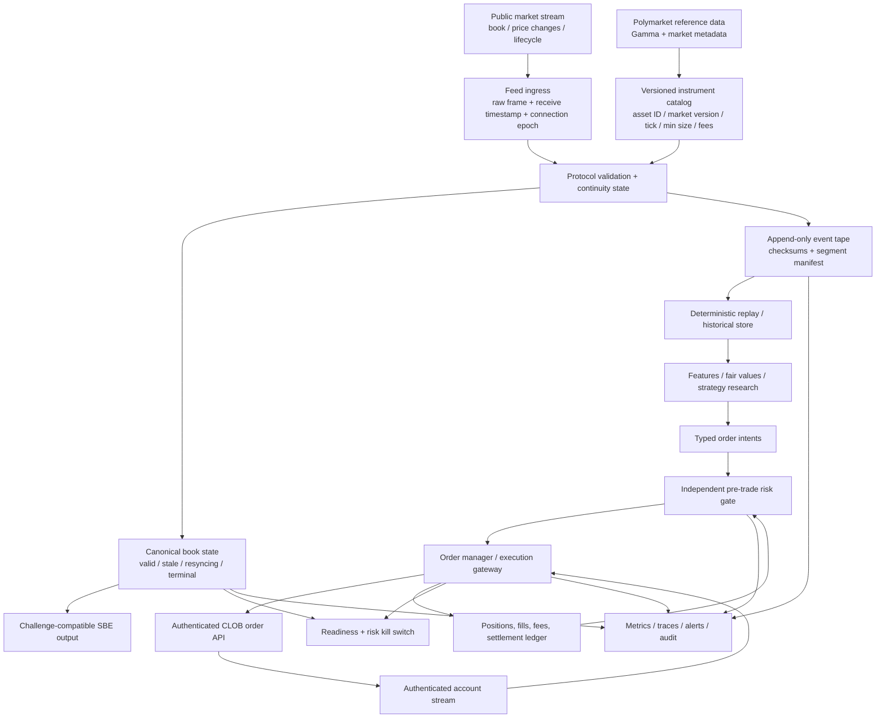

# Polymarket Production Programme

**Status:** Active engineering plan; this document sets gates, not a claim of production readiness.  
**Baseline:** `kj111422/engineering-challenge-template` `main` at `9ab6cd5a584fea58c0086efa50d55c796e9aac4` (2026-10-26).  
**Primary objective:** Turn the challenge collector into a reliable Polymarket market-data, research, risk, and controlled-execution platform.  
**Execution policy:** Public-data collection and replay are permitted by default. Private credentials and live order transmission remain disabled until the relevant gates pass.

## 1. Current baseline: what exists and what does not

The current application is a Rust market-data collector. It includes Gamma keyset discovery, a public Polymarket CLOB market WebSocket adapter, normalized order-book state, redundant source workers, recovery snapshots, an aligned SBE writer, metadata/catalog persistence, capacity preflight, health/readiness metrics, replay, inspection, verification, and mock-exchange tests. Kalshi support remains part of the challenge baseline; Polymarket is the production-development focus.

The current `main` commit has passing GitHub Actions runs for the Rust CI workflow and architecture workflow:

- [CI — `9ab6cd5`](https://github.com/kj111422/engineering-challenge-template/actions/runs/40403111336)
- [Architecture documentation — `9ab6cd5`](https://github.com/kj111422/engineering-challenge-template/actions/runs/40403111133)

The `main` commit records 185 passing tests and 3 ignored opt-in tests. The continuity branch at `13bc7e0` records 205 passing and 3 ignored on the same suite ([Rust CI](https://github.com/kj111422/engineering-challenge-template/actions/runs/40522906788)). A green build establishes that the tested source compiles and the checked invariants hold; it does not prove that a long-running live feed is complete or that the application can trade safely.

### Explicit current limitations

- The Polymarket adapter consumes public market data. The application does not yet implement an end-to-end authenticated order-management system.
- There is no strategy-independent portfolio ledger that reconciles open orders, partial fills, failed settlement, balances, and positions.
- There is no independent pre-trade risk service that must approve every order intent.
- The current verifier checks capture self-consistency against recorded snapshots. It cannot prove that every event published by a live venue was received.
- Polymarket does not expose a sequence field in this adapter's normalized event contract (`EventMeta.seq` is `None`). A reconnect and fresh book re-anchor state, but they cannot reconstruct every delta missed during an outage. Gaps must be represented as data-quality incidents, not hidden.
- Full-universe live subscription, sustained soak, and authenticated account/order reconciliation are not established by the current CI gates.

No document, dashboard, or metric should describe these capabilities as implemented until the code path and tests demonstrate them.

## 2. Target architecture

### Boundary rules

1. **Market-data and execution are separate trust boundaries.** Public ingest must not hold a private key or be able to submit an order.
2. **Strategies emit intents, not API calls.** Every live order passes through independent limits and risk checks.
3. **Unknown state blocks risk-increasing actions.** Stale books, missing metadata, uncertain orders, failed persistence, account-stream disconnects, and unresolved reconciliation must fail closed for new exposure.
4. **Evidence is append-only.** Preserve received frames and decision/order events with receive timestamps, a connection/session epoch, and checksums. Keep SBE as the challenge output contract; do not silently change its schema to carry an internal journal.
5. **A match is not settlement finality.** Represent order status and trade/settlement status separately. Reconcile account events with periodic REST snapshots.
6. **Every production claim has a reproducible gate.** Record commit SHA, config hash, source set, venue environment, time window, tests, and measured resource/latency distributions.

## 3. Programme phases and exit gates

### P0 — Baseline and source-of-truth hygiene

**Goal:** A reviewer can identify which code and evidence are current.

- Keep the passing baseline immutable; development changes go through topic branches and pull requests.
- Mark the old `docs/architecture.md` content as a historical audit of the 2026-10-26 ZIP, not the active runtime architecture. Publish a current Polymarket target and clearly label implemented versus planned nodes.
- Make the README describe the product honestly: current system = market-data collector; production target = Polymarket trading platform; order entry and risk controls are not yet implemented.
- Each test/benchmark report pins the exact commit and configuration. Never carry test counts forward automatically after code changes.

**Exit gate:** README, architecture, inventory, and verification evidence refer to the same commit and no stale document labels the current tree “blocked”.

### P1 — Polymarket feed contract and data-quality state machine

**This is the first implementation milestone.**

- Maintain a versioned set of raw WebSocket fixtures based on the current official contract. Cover book snapshots, multi-asset `price_change` frames, tick-size changes, new-market/resolution messages, unknown additive events, malformed events, and keepalive/control frames.
- Keep CTF token IDs and Protocol V2 position IDs as distinct instrument-identity cases. Never infer identity from a mutable slug or question.
- Record and validate market metadata required for pricing and order validation: active/closed/accepting-orders status, market version and asset identifier, tick size, minimum order size, and applicable fee information when available. Never promote missing/unknown fields to safe defaults without a named policy.
- Add a per-symbol feed state such as `UNSEEDED`, `LIVE`, `STALE`, `RESYNCING`, and `TERMINAL`. No delta may mutate a book outside the state allowed by its transition.
- Preserve complete-frame validation: a malformed element in an atomic batch must not partially mutate book state.
- Expose freshness and recovery telemetry by source and symbol cohort. A fresh connection is not the same as a fresh, exchange-anchored book.
- When an outage, malformed frame, or stalled subscription makes continuity uncertain, invalidate readiness, re-subscribe, obtain a new book, emit a discontinuity record, and only then declare the symbol live again.
- Use server-provided book hashes or best-bid/ask fields only as corroborating evidence when present. Do not treat optional hashes as a sequence number or proof that no message was missed.

**Tests required:** golden wire fixtures; protocol-version/identifier tests; malformed-batch atomicity; fixed-point/tick-boundary tests; lifecycle transitions; reconnect/resubscribe; no stale-book trading eligibility; deterministic replay across reconnect; and a test proving that the system reports a known gap rather than claiming complete data.

**Exit gate:** zero unexplained decode failures in the checked-in fixture corpus; every state transition has a test; stale or unanchored symbols cannot be reported ready; malformed frames cannot partially mutate a book; and outage intervals are visible in reports/captures.

### P2 — Durable event tape and recovery

- Keep normalized SBE output for compatibility, but add a separately versioned raw-frame journal for forensic reconstruction.
- Write append-only segments with a manifest, length/checksum validation, clear timestamp semantics, and explicit finalization after close.
- Define disk-full, permission, fsync, partial-write, and shutdown-timeout behavior. Fail loudly; never claim successful durability before the configured sync policy completes.
- Refuse accidental overwrite by default. Test restart behavior against incomplete final segments and corrupt manifests.
- Set retention and disk-watermark policies; demonstrate that retention cannot delete an unfinalized or still-referenced segment.

**Exit gate:** fault-injection tests cover write failure, sync failure, interrupted finalization, disk exhaustion behavior, and restart recovery. Every accepted event is either durably accounted for or causes an explicit failed/incomplete run report.

### P3 — Historical storage, replay, and research data

- Build a canonical historical format with event time, receive time, instrument version, source epoch, raw-message provenance, normalized events, and discontinuity markers.
- Partition by date/venue and retain an index from market/outcome IDs to events. Select compression and columnar formats from measurements, not fashion.
- Make replay deterministic: a run records strategy/model revision, parameters, code SHA, data manifest, fee schedule, and clock assumptions.
- Separate event-time analysis from receive-time execution simulation. Do not silently sort source data and thereby remove observed latency/skew.
- Build independent reconciliation tooling comparing the collector's reconstructed books with fresh venue snapshots and preserved raw messages.

**Exit gate:** identical inputs and revisions reproduce identical outputs; corruption and missing segments are detected; a second implementation can read the archive; and reconciliation reports quantify unknown/missing intervals.

### P4 — Strategy research and credible backtesting

- Start with baseline models and descriptive market statistics before adding ML: spread, depth, microprice, imbalance, trade flow, volatility, tick rules, liquidity, fees, and market/settlement metadata.
- Model venue-specific fee schedules and fee changes. Do not backtest gross edge as if it were net PnL.
- Model partial fills, queue priority uncertainty, cancel/replace latency, stale quotes, rate limits, rejected orders, inventory, adverse selection, market-resolution exposure, and settlement delays.
- Split data chronologically; prevent look-ahead across outcome resolution, corrected metadata, and revised event records. Keep a frozen test period and a simple baseline for comparison.
- Report net PnL, turnover, drawdown, calibration, exposure, fill rates, markouts, cost decomposition, and confidence intervals. Track performance by market family and liquidity regime.

**Exit gate:** every strategy must beat a declared baseline after fees and conservative fill assumptions on a held-out period, remain within risk limits under stress scenarios, and include a reproducible research report. This is not a guarantee of future performance.

### P5 — Order management, account truth, and independent risk

No live order submission belongs in the data collector.

- Add a separate execution process with an explicit interface for typed order intents, account state, order state, and risk decisions.
- Implement the Polymarket authentication/signing flow against the current official API contract. Verify signer/domain/market-version behavior with deterministic conformance vectors and test credentials before considering live credentials. Do not improvise cryptographic signing from examples alone.
- Implement explicit order states, including unknown/ack-pending, live, partially matched, cancelled, rejected, and terminal states. Treat timeout after submit as an ambiguous outcome: query/reconcile before retrying; never blindly duplicate an order.
- Consume the authenticated user stream for order/trade events and reconcile it against periodic REST snapshots. Account for partial matches and nonterminal settlement states (`MATCHED`, mined/pending, retrying) separately from final confirmation or failure.
- Maintain a double-entry or equivalently auditable ledger for cash/collateral, positions, open-order exposure, fees, realized/unrealized PnL, and settlement/redemption. Rebuild it from the event journal and compare it with venue state.
- Enforce limits independently of strategy code: per-order notional, per-token and per-condition exposure, event/theme concentration, gross/net exposure, loss/drawdown stops, stale-data bans, price collars, order-rate limits, and balance/collateral checks.
- Include an operator-controlled kill switch that blocks new orders and cancels open orders. Test it during account-stream loss, REST failure, process restart, clock problems, and unexpected fills.
- Keep secrets out of the market-data process, logs, capture files, CI artifacts, and source history.

**Exit gate:** simulated accounts reconcile after every scenario; fault-injected ambiguous submission cannot duplicate exposure; every order has an auditable risk decision; kill-switch tests pass; and execution runs in paper mode only.

### P6 — Paper trading and shadow operation

- Run the feed continuously with order generation enabled but real submission impossible by construction (no signer/key in the process and no route to the order endpoint).
- Compare simulated fills with market updates and conservative queue/latency assumptions. Reconcile virtual positions and cash every cycle.
- Establish measured SLOs for book freshness, time-to-recover, write durability, API error rates, unknown-order duration, and risk-gate latency. Derive thresholds from recorded distributions and business risk, not arbitrary benchmark targets.
- Exercise restarts, DNS/network loss, server close frames, rate limiting, stale metadata, market resolution, disk pressure, and clock steps.

**Exit gate:** sustained soak of a pre-agreed duration; no unexplained feed gaps or ledger mismatches; operational alerts fire in drills; all incidents have runbooks; and paper PnL survives conservative assumptions. The duration and numerical SLO thresholds must be agreed and pinned before the run.

### P7 — Restricted live canary

This phase requires explicit human approval and legal/venue eligibility review.

- Start with one strategy and a small, predefined market set; enforce a small hard capital cap and per-market exposure cap.
- Require an operator approval before enabling order submission. Default configuration, tests, and local development mode must keep the live-order capability off.
- Keep a kill switch outside the strategy process. Confirm cancellation and account reconciliation after every canary session.
- Increase limits only after a documented review of feed quality, realized slippage, fills, exposure, settlement, and operational incidents.

**Exit gate:** no scaling on strategy PnL alone. Require reconciliation, risk, reliability, audit, operational, and compliance sign-off.

## 4. Priority order for the next engineering changes

1. **Documentation truth and Polymarket target definition** — this document plus a clear marker on the historical architecture audit.
2. **P1 feed-contract fixtures and data-quality states** — add tests first, then implementation. Avoid changing the challenge SBE schema in this workstream.
3. **Raw-frame audit tape and discontinuity markers** — preserve what arrived, what was normalized, and when confidence was lost.
4. **Independent snapshot reconciliation and sustained soak harness** — establish real-world data-quality evidence before strategy research.
5. **Historical research and deterministic replay improvements.**
6. **Paper OMS + risk ledger.**
7. **Restricted live execution only after all previous gates pass.**

Each step should be its own small pull request, with one behavioral objective, regression tests, a commit-pinned report, and passing CI. Do not combine feed changes, order submission, and strategy logic in one PR.

## 5. Production standards

- **Correctness before latency.** First measure end-to-end distributions and quantify data gaps; then optimize the demonstrated bottleneck.
- **No hidden failure.** Every loss of continuity, persistence error, order ambiguity, and reconciliation mismatch changes a visible health state and is recorded.
- **Risk is independent.** Strategies cannot edit limits, bypass the gate, or hold signing keys.
- **Reproducibility.** Every result pins data, code, config, parameters, venue identifiers, and model revisions.
- **Fail closed.** Unknown market metadata or account/order state blocks new risk.
- **No unsupported claims.** Local tests, mock-exchange tests, public-feed smoke tests, full-universe discovery, and live trading are distinct forms of evidence.
- **No proprietary imitation claim.** Use the standard principles of integrated trading, research, technology, controls, and real-time visibility associated with professional quantitative firms; do not assume access to or reproduce any firm's private implementation.

## 6. Current external contract references

Review these pages before implementing a venue-dependent change; the venue contract can evolve independently of this repository.

- [Polymarket real-time market data](https://docs.polymarket.com/market-data/realtime-data) — book, price changes, tick-size changes, and market events. The documented unified interface distinguishes CTF token IDs from Protocol V2 position IDs.
- [Polymarket order placement](https://docs.polymarket.com/trading/place-orders) — order types, post-only behavior, and order constraints.
- [Polymarket real-time order updates](https://docs.polymarket.com/trading/realtime-order-updates) — authenticated order/trade events and trade status lifecycle.
- [Polymarket trading quickstart](https://docs.polymarket.com/trading/quickstart) — current client/authentication approach.
- [Polymarket market making](https://docs.polymarket.com/market-makers/overview) — venue-specific market-making concepts; verify current URL/contract before use.
- [Jane Street overview](https://www.janestreet.com/what-we-do/overview/) — public description of integrated trading, research, technology, and real-time visibility. This is inspiration for engineering principles, not a specification of internal systems.

---

**Current disposition:** Keep live trading disabled. Begin with P0 documentation truth and P1 feed-contract/data-quality tests. The next milestone is not “place the first order”; it is “prove when Polymarket market state is trustworthy, stale, or incomplete, and make the system behave accordingly.”
